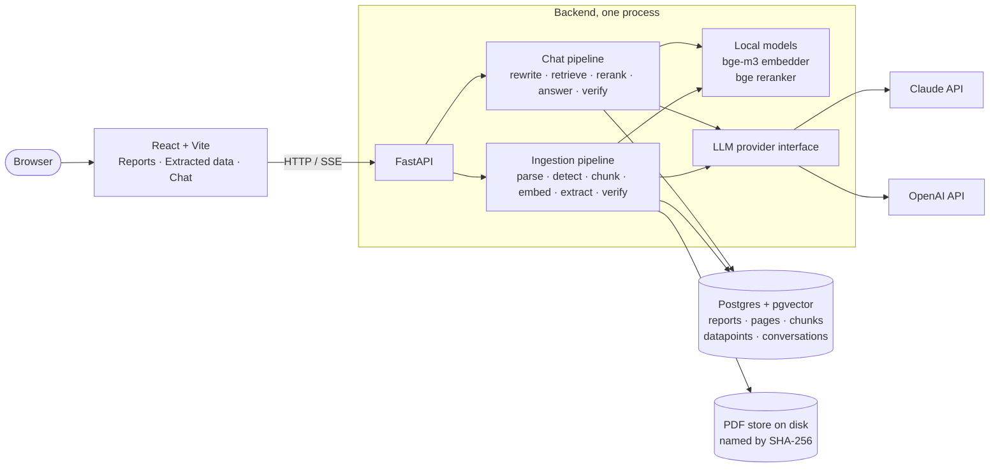

# Annual Report RAG Analyzer: Design

How the application is built, why each part is built the way it is, and what to change
next. It follows the order of [PLAN.md](PLAN.md): ingestion pipeline, chat pipeline, UI,
tests, evaluation. Every component has a description and an **Improvements** list.

Related documents:

* [README](../README.md): how to run it
* [PLAN.md](PLAN.md): what is done and what is open
* [EVAL.md](EVAL.md): how well every stage works on six reports and 57 questions

## 1. What the application does

A local full-stack Retrieval-Augmented Generation (RAG) application for company annual
reports in PDF form.

1. **Upload reports** (one PDF or a whole folder): each is parsed, chunked, embedded and
   indexed in the background.
2. **Browse extracted data**: datapoints pulled out of every report at ingestion (FTE,
   revenue, net profit, dividend per share, sustainability goals), each with a quote and a
   link to its page.
3. **Chat with the reports**: natural-language questions, follow-ups, comparisons across
   companies and years; every answer cites report passages and the cited page opens next to
   it.

The principle behind everything: **every figure shown comes with a verbatim quote, checked
in code against the PDF text**.

## 2. Architecture diagram

### Request flows

- **Upload**: the backend checks the PDF magic bytes, hashes the file, rejects duplicates,
  stores it under its hash, creates a `pending` report row and schedules the background
  task. The response lists what started and what was rejected and why; the Reports page
  polls every 2.5 s while anything is ingesting.
- **Chat**: the browser posts the question and receives server-sent events: `conversation`
  (the id), `stage` events (`analyzing`, `retrieving`, `generating`) that drive the status
  line, then exactly one `answer` or `error`. The pipeline is blocking, so it runs in a
  worker thread and hands events to the event loop through a queue. **The answer is stored
  before it is sent**, in the shape the UI reloads, so what the user saw live is what they
  see later.

## 3. Tech stack

| Layer | Choice | Why this one |
|---|---|---|
| Backend | Python 3.12, FastAPI, Pydantic v2, SQLAlchemy 2 + Alembic, `sse-starlette`, `uv` | Typed end to end: the same Pydantic models define the LLM output schemas, the API responses and the validation. One process, async HTTP, server-sent events for the chat |
| Database | Postgres 16 + pgvector | One store for relational data, vectors and full-text search, with real transactions and cascading deletes. No second system to keep in sync |
| PDF parsing | PyMuPDF | Fast on CPU, gives text blocks in reading order and table boundaries, no external service. Scored 1.00 on a labelled set of 26 hard pages (see Tests) |
| Embeddings | `BAAI/bge-m3`, run locally through sentence-transformers | No API key, no per-token cost, multilingual, 8k-token context. The index stays valid when the LLM provider changes |
| Reranker | `BAAI/bge-reranker-v2-m3`, local cross-encoder | Reads query and chunk together, the largest quality gain in retrieval; its score is a probability, so it can also drive abstention |
| LLM | Claude (default) or OpenAI, selected in `.env` | Strong structured output and prompt caching. Two providers behind one interface prove the design is not tied to a vendor |
| Frontend | React 19 + Vite + TypeScript, Tailwind v4, react-router 7 | Three pages, a typed API client, a hand-written SSE parser; no component library |
| PDF viewing | The backend renders a cited page to PNG | One request per citation instead of loading a 400-page PDF in the browser; the full PDF is one click away |
| Tooling | ruff, mypy, pytest; eslint, prettier, tsc; Makefile | Lint and type checks on both sides |

Model roles, configurable in `backend/app/config.py`:

| Role | Anthropic | OpenAI | Used for |
|---|---|---|---|
| Main model | `claude-sonnet-5-5` | `gpt-5` | Answers, datapoint extraction |
| Small model | `claude-haiku-4-5` | `gpt-5-mini` | Company and year detection, query rewriting |

Cheap, frequent, easy calls go to the small model; calls where reading comprehension and
verbatim quoting matter go to the main one.

## 4. Ingestion pipeline

- Runs as a **FastAPI background task with its own database session**, moving a report
  through `pending`, `parsing`, `chunking`, `embedding`, `extracting`, `ready` (or
  `failed`). Status and progress are written after every stage and, within long stages,
  after every batch.
- **The status tracks the index, not the extraction.** `ready` means the pages, chunks and
  embeddings are complete and the report can be searched (chat already works while it is
  `extracting`). How each registry entry fared is recorded separately in `extractions`, one
  row per report and entry: `extracted`, `not_found` (the model saw the candidate passages
  and found nothing) or `error` with the message. A provider error on one entry is recorded
  on that entry and the rest of the registry still runs; it is never stored as "nothing
  found". The UI shows failed entries next to a retry, and `POST /api/reports/{id}/extract`
  runs the chosen entries again without parsing or embedding the PDF again.
- **An error while building the index is stored on the report** and shown in the UI.
  Reports still in progress when the process starts are marked failed ("interrupted by a
  restart"), except those that were already extracting: their index is complete, so they
  become `ready` with the interrupted entries marked failed, ready for a retry.
- On an M-series Mac a report of about 345 pages takes **3.2 minutes** on average (17%
  parsing, 25% embedding, 57% extraction) and **$0.14 to $0.21** of LLM calls, almost all
  of it extraction; on CPU in Docker, 10 to 15 minutes.

### 4.1 Upload and storage

- Files or a folder; folders are walked in the browser and every PDF goes in one multipart
  request.
- Each file is checked for the `%PDF-` header, **hashed with SHA-256 and stored as
  `<hash>.pdf`**. The hash is a unique column, so the same bytes can never be ingested twice,
  even if two uploads race (the loser gets "already ingested as Shell 2025").
- Rejections never fail the batch: the response lists started reports and rejected files
  separately.
- Deleting a report removes the row; the database cascades to pages, chunks and datapoints
  without loading vectors into memory, and the file is unlinked afterwards.

### 4.2 Parsing

- PyMuPDF returns text blocks with coordinates; **blocks are sorted top to bottom, left to
  right**, which keeps paragraphs intact and two-column pages in order.
- **Tables**: PyMuPDF's table finder gives boundaries; a table is kept only with at least 2
  rows and 3 numeric cells, which drops layout grids and navigation bars. The raw text inside
  the boundary is stored rather than the cell grid, because cell extraction merges the
  columns of borderless tables.
- Each page ends with **two texts**: the full text (source of truth for quote verification)
  and a body text with table regions removed (what gets chunked). Hyphenated words are
  rejoined.
- The parser has its own quality dataset: **26 labelled pages** (financial tables, five-year
  tables, infographics, two-column text, navigation bars) with text that must be recovered,
  cells that must land in a table, pages with no table, reading-order pairs. **All four
  categories score 1.00.**

**Improvements**

- **Page furniture**: running headers and navigation bars are read as text on almost every
  page of some reports; in CM.com's reports the bar sits at the start of half the chunks and
  dilutes their embeddings. Strip lines that repeat on 20% or more of a report's pages
  before chunking; needs a re-ingest.
- **Infographics and charts**: key-figures pages drawn as graphics come out as digits
  without labels. Send pages with little text and many numbers to a vision model; a
  layout-aware parser is the cheaper first step.
- **Table representation**: a table chunk is raw text in reading order, so a row label and
  its column header can be far apart. Rendering rows with the header repeated would help
  both retrieval and the model's reading.

### 4.3 Chunking, embedding and indexing

- **Windows of 400 words with 60 words of overlap** per page body, so a sentence cut by a
  boundary is whole in the next window. **Each table is one chunk**, never cut. Chunks under
  5 words are dropped. A chunk never spans pages: the page is the citation unit. No section
  structure is inferred, because headings in these reports are too inconsistent.
- **Readable chunk ids** (`shell-2025-a1b2c3-p87-c412`: company, year, report id fragment,
  page, running number), because the LLM copies them into citations and copies a readable
  id more reliably than a UUID.
- **Contextual header** before embedding: `[Shell | Annual Report 2025 | p. 87]`, put in
  front of the chunk wherever it is used (embedding, reranking, the answer model's context).
- **Embedding** runs locally with `bge-m3`, normalised vectors, in slices of 512 chunks per
  `encode` call, progress updated per slice. Vectors go into a pgvector column; a generated
  `tsvector` column with a GIN index gives full-text search over the same rows. On a Mac the
  models run on Metal; loading one model while another encodes crashes Metal, so loading and
  inference share one lock.

**Improvements**

- **An approximate-nearest-neighbour index**: vector search is an exact scan today,
  milliseconds at 5,000 chunks; hundreds of reports would need an HNSW index, one pgvector
  migration.
- **Small-to-big retrieval**: the full page text is stored, so a chunk that looks cut could
  be expanded to its page before it goes to the model.
- **Section names in the header**: "Section: Climate" would help questions about a topic
  rather than a figure, if section titles can be recovered from the PDF outline.

### 4.4 Metadata detection

- The small model reads the **first three pages** (2,500 characters each) and the file name
  and returns company short name, fiscal year and title as JSON.
- Runs right after parsing, because chunk ids and contextual headers need company and year.
  If the call fails the report keeps the file name as company and year 0, so it stays
  visible and deletable.
- **6 of 6 reports right** in the evaluation, about one second each.

**Improvements**

- The detected name is what scoping relies on ("ABN AMRO" in a question must match the
  header). A normalised company list, or letting the user correct the detected values,
  would make that robust against "Shell plc" versus "Shell".
- A fiscal year is one integer; a start and end date would cover years that do not match
  the calendar.

### 4.5 Pre-extraction of datapoints

- **Datapoints are configuration**, not code: `extraction/registry.yaml` holds, per entry, a
  key, a label, single or multi-value, retrieval queries, the number of chunks for the model
  (`top_k`) and instructions in plain English. Five entries ship: FTE, revenue, net profit,
  dividend per share (3 queries and 10 chunks each) and sustainability goals (6 queries and
  32 chunks).
- **Candidates**: every query runs through the chat's hybrid search and reranker, restricted
  to the report and with the reranker floor off (recall matters more here); a few chunks per
  query, the union cut to `top_k`, passed to the main model in page order.
- **One model call per entry**; the six calls of a report run **concurrently**. The gain is
  small (about 10 s of a 100 s stage), because the goals call dominates the wait and most of
  the stage is candidate retrieval: 18 queries with 60 reranker pairs each. The model returns items
  with label, value exactly as written, unit, period, qualifiers, a verbatim quote and the
  chunk id it came from. Duplicates (same label, value and period, or same quote) are
  dropped.
- **Every quote is verified** against the stored page text (5.4) and stored with a
  `verified`, `fuzzy` or `failed` badge; text fields are cut to their column length so a long
  qualifier can never fail the insert. The value is parsed to a number ("23,500", "1.2
  million", "(3,786)") for sorting and evaluation.
- **The instructions carry the domain knowledge**: group-wide year-end FTE over the average,
  "total operating income" is a bank's revenue, dividend per share is interim plus final, a
  target whose year is past is a result, not a goal. The shared system prompt adds the
  rules for every entry: only the chunks, never round or rescale, prefer the most precise
  statement of a figure.
- **Results** on the six evaluation reports: every single-value figure exact or a defensible
  alternative the report also states, **none wrong**, one missing; goals **precision 0.97,
  recall 0.56** (0.73 on the headline goals).

**Improvements**

- **Fewer reranker pairs**: about 1,080 pairs per report, around 60 s on the GPU; 20
  candidates per query instead of 60 would cut most of it.
- **Page-level extraction for goals**: the ceiling on recall is retrieval (37 of 54 missed
  goals were on pages the queries did not reach). Use the candidate chunks to locate the
  sustainability pages, then send those whole pages, or the chapter, to the model.
- **Revenue precision**: when the income statement is not among the candidates the model
  takes a rounded figure from prose; a query that names the income statement is the
  config-level fix.
- **User-defined datapoints**: an editor in the UI, or an upload of a registry file, would
  let an analyst add a field without a deployment.

## 5. Chat pipeline

Five steps: **rewrite** the question so it stands alone and split it into sub-queries,
**retrieve** candidates per sub-query, **rerank** and decide whether to abstain, **generate**
a structured answer with citations, **verify** every quote. The median question takes
**7.5 s** (about 1 s rewriting, 4 s retrieving and reranking, 2.5 s generating) and costs
**$0.018**.

### 5.1 Query rewriting and decomposition

- Retrieval needs a standalone query, but users write "and the year before?". The small
  model gets the conversation and the latest question and returns:
  - the **question rewritten to stand alone**, in the user's language, pronouns resolved;
    the answer is written for it and the UI shows it as "searched for ...";
  - **sub-queries, one per company, fiscal year and topic**, each a standalone English
    question naming its company and year. "ASML vs ABN AMRO headcount in 2025" becomes two.
- The model fills company and year before writing the question; if the text still lacks
  them, retrieval appends them phrased like the chunk headers ("... ASML annual report
  2025"). At most ten sub-queries are searched. If the call fails, the raw question is
  searched.
- **What the rewrite sees is asymmetric**: every earlier question (up to 30) but only the
  answers within the last six messages, because questions carry the company and year a
  follow-up refers to and answers only matter for what was just said. Raw questions, not
  earlier rewrites, so one wrong rewrite never contaminates the next.
- **Decomposition is what makes comparisons work**: each side gets its own retrieval budget;
  all 8 comparison questions in the evaluation were answered correctly.

**Improvements**

- **Tell the rewrite which companies exist**: with the list of ingested companies and years
  it could map "the bank" to ABN AMRO and say plainly when a company has no report.
- **An agentic variant for open comparisons** ("which company has the most employees?"): a
  `search_reports(query, company, year)` tool the model calls several times, at the cost of
  latency and predictability. The fixed pipeline came first because it is easier to
  evaluate.

### 5.2 Hybrid retrieval, reranking and abstention

- Per sub-query, **two searches** over all indexed reports (or the user's selection): a
  pgvector cosine search and a Postgres full-text search matching any word of the query,
  ranked by `ts_rank_cd`. **60 candidates each**, fused with **Reciprocal Rank Fusion**
  (k = 60), which only looks at ranks, so the two score scales never need calibrating.
- The fused top 60 go to the **cross-encoder reranker**, which returns a probability that the
  chunk answers the query. Chunks **below 0.2 are dropped, the top 8 kept** per sub-query;
  the sub-queries' chunks are merged, a chunk found twice kept once with its best score.
- **The 0.2 floor is the first abstention gate**: questions about companies outside the
  corpus score low, answerable questions score 0.96 or more. When nothing survives, or there
  is no indexed report to search, the pipeline answers "not stated in the report" without
  calling the main model. Plausible questions the reports do not answer score high anyway,
  so for those the model has to say so, and it did for every one.
- Reports are searchable as soon as their index is complete, while extraction still runs. A
  user filter is never widened.
- **Results**: a gold page among the retrieved chunks for 95.7% of answerable questions,
  every key fact retrieved for 93.5%, MRR 0.61.

**Improvements**

- **Filter each sub-query by its company and year.** The rewrite outputs both, but they are
  only appended to the search text, so 21% of retrieved chunks come from the wrong report,
  mostly the other year of the same company. A report filter fixes that; combine it with
  the ingested-company list in the rewrite and a fallback to the unfiltered search when the
  filter matches nothing.
- **Keep 12 chunks instead of 8**: three gold chunks landed at rank 9 to 12; with the year
  filter the extra chunks would all be from the right report.
- **Fix or drop full-text search**: added for exact terms (FTE, Scope 3, EUV) but given whole
  sentences, it adds little; build it from the sub-query's key terms or a BM25 index, or
  drop one search per sub-query.
- **Reranker throughput**: 60 pairs per sub-query at about 60 ms each is the largest part of
  latency; batching the sub-queries' pairs into one call, or a smaller first-cut reranker,
  would bring a three-sub-query question from 13 s towards 6 s.

### 5.3 Answer generation with structured output

- The main model gets **the whole conversation as real turns**; the final user message holds
  this question's chunks (each with its citable id and header) and the standalone question.
  Earlier turns carry only text, never their chunks, so every answer is grounded in and
  verified against this turn's evidence alone.
- Sending the whole conversation keeps the prefix append-only, which is what makes **prompt
  caching** work: system prompt and earlier turns come from cache, only the final message
  is paid in full.
- **The reply is JSON validated by a Pydantic schema**: a status (`answered`, `partial`,
  `not_found`), the answer as short prose with every figure carrying unit and period, and
  citations, each a chunk id and a quote copied character for character. Instructions:
  prefer the sentence or table row with the number, never use outside knowledge, use
  `partial` when the report gives a related but different figure.
- **Results**: 91.3% of answerable questions correct, 95.7% correct or partial, **0%
  incorrect**, all 11 unanswerable questions handled without inventing a figure.

**Improvements**

- **Check the numbers in the prose, not only the quotes**: 16% of correct answers add a side
  figure read in a chunk but not quoted. A code check that every number in the answer is in
  a verified quote (with scale normalisation) would flag these as "figure not quoted".
- **Stream the answer**: stages stream, the answer does not, because the JSON is validated
  whole; incremental parsing of the `answer` field would make generation feel shorter.
- **Table reading**: both generation failures in the evaluation were tables the model
  skimmed; asking it to check table chunks cell by cell is a prompt change, a better table
  rendering (4.2) the structural fix.

### 5.4 Quote verification

Every quote, from chat and extraction, goes through one function that answers: **is this
text really on that page of that report?**

1. A citation of a chunk id the model was never given **fails immediately**.
2. Sources: the stored text of the chunk's page (source of truth) and the chunk's own text
   (a table chunk is clipped to the table region and can read differently). A match in
   either counts.
3. **Normalisation** of quote and sources: Unicode NFKC, typographic quotes and dashes
   unified, ligatures expanded, soft hyphens removed, whitespace collapsed, lower-cased.
   Models do not reproduce PDF typography and should not fail for it.
4. An exact substring is **`verified`**. Otherwise RapidFuzz `partial_ratio` (best alignment
   of the quote against any window of the source): **0.92 or above is `fuzzy`**, below is
   `failed`. A quote longer than its source is compared whole, so a short chunk hidden in a
   long invented quote cannot score 1.

- **What the status does**: verified is a green badge; fuzzy is amber and still counts as
  support; failed is struck through. An `answered` reply whose citations all failed is
  **downgraded to `not_found`** and its text replaced, because it states figures nothing
  supports (the original is kept in the metadata). Datapoints are stored whatever the status
  and show it, so a failed one is visible rather than dropped.
- **The threshold** was chosen on 570 generated quote variants from the fixture reports: real
  quotes with small edits passed 96%, invented text was rejected 100%. In the evaluation,
  **106 of 106 chat citations verified exactly**.

**Improvements**

- **Fuzzy is a warning, not a proof**: a changed digit or an inserted "not" is a small edit
  above 0.92. Requiring the quote's digits unchanged in the matched window would close the
  digit case.
- **Show the difference** on a fuzzy match, so the user judges it in a second.
- **Highlight the quote on the page image**: PyMuPDF can search a page and return
  rectangles; one more endpoint.

### 5.5 LLM providers

- **One small interface**: system prompt, optional earlier turns, user message, a Pydantic
  schema, a `small` flag for the model. Each adapter uses its provider's native JSON-schema
  mode; the reply is validated with Pydantic, a failure is sent back once as a **repair
  retry**, a second failure raises a clear error. Provider exceptions map to one error type
  the UI can show.
- **The Anthropic adapter streams** every response (a long goal list is not cut by the HTTP
  timeout), detects truncation at `max_tokens` and reports it as an error, and places cache
  breakpoints on the system prompt and the last earlier turn. OpenAI caches shared prefixes
  automatically, so its adapter keeps the prefix byte-identical.
- **Token usage**, including cache reads and writes, is logged per call; the evaluation
  harness hooks into it for cost.

**Improvements**

- **Local and smaller models**: an Ollama or vLLM adapter is an afternoon; what is missing is
  the evaluation of whether a local model keeps quotes verbatim.
- **Cost and tracing in the product**: usage is logged, not stored; writing tokens and cost
  per call to the database, or sending traces to Langfuse, would answer "what did this
  report cost" from the UI.
- **Retries with backoff** on rate limits; today the chat reports the error and extraction
  continues without that datapoint.

## 6. Data model

Seven tables in Postgres, two Alembic migrations:

- **`reports`**: company, fiscal year, title, original file name, SHA-256 (unique), page
  count, status, progress, error.
- **`pages`**: one row per PDF page with its full text; the source of truth for verbatim
  checks and the unit of citation.
- **`chunks`**: readable id, report, page, kind (`text` or `table`), content, embedding
  (pgvector), word count, a generated `tsvector` column with a GIN index.
- **`datapoints`**: report, registry key, label, value as written, parsed numeric value,
  unit, period, qualifiers (JSON), quote, chunk id, page, verification status, the model.
- **`extractions`**: one row per report and registry key with the outcome of the last
  extraction attempt (`pending`, `extracted`, `not_found`, `error`), the error message and
  the model. It tells "nothing found" and "the call failed" apart, which the datapoints table
  alone cannot.
- **`conversations`** and **`messages`**: an assistant message stores its status, its
  citations with verification results, and metadata (standalone question, sub-queries,
  retrieved chunk ids, best reranker score), so a reloaded conversation shows exactly what
  was shown live and a bad answer can be debugged from the database alone.

Deletes cascade in the database. Everything survives a restart.

## 7. User interface

Three pages behind a header that always shows the configured provider, models and reranker.

- **Reports**: drop PDFs or a folder, upload in one request, per-file rejections, a status
  badge and progress bar per report, polling only while something ingests, delete with
  confirmation.
- **Extracted data**: one section per registry entry across all companies, with a report
  filter. Single values show value, unit, period and qualifiers; goals list their items.
  Every row has the verification badge, the quote and a page link that opens the page image
  in a side panel.
- **Chat**: saved conversations, a report filter, a status line following the stage events,
  the answer with its status badge, citation chips that open the cited page, failed quotes
  struck through, and the standalone question the search used, so a wrong rewrite is
  visible.
- The cited page is a **PNG rendered by the backend** at 144 dpi, cached for a day; the full
  PDF opens at that page in a new tab. The SSE client is a small hand-written parser with a
  60-second idle timeout.

**Improvements**

- Highlight the quote on the page image (5.4); stream the answer text (5.3).
- Sorting, filtering and CSV export on the Extracted data page; a cross-company view (one
  row per company, one column per year).
- Let the user correct detected metadata and re-run extraction from the Reports page.
- A per-answer "show the chunks" toggle; the data is already in the message.

## 8. Tests

- **Unit tests**, offline, no database or models: chunk windows and tables, quote
  verification including the fuzzy cases, RRF merging, number parsing, the provider's repair
  retry and cache breakpoints, how much history the rewrite gets, the report-scope rules,
  the cleanup of extracted units.
- **Rewrite behaviour tests** against the real small model (skipped without an API key):
  a company and year named many turns back, companies and years mixed across sub-queries,
  topics merged or split, questions about all companies, how many sub-queries one question
  may produce.
- **Parser quality**: a floor per category over the 26 labelled pages; a separate command
  prints the scorecard with every failing label.
- **Integration test** against a real Postgres and the configured provider: upload a
  generated PDF, wait for ingestion, check datapoints, chat, conversation ordering, page
  render, delete. Skipped without an API key.
- **Frontend**: TypeScript type checks, ESLint with type-aware rules, Prettier. No browser
  tests.
- `make test` and `make lint` run all of it.

**Improvements**

- **Continuous integration**: a GitHub Actions workflow with a pgvector service container
  and a small embedding model, running lint, unit tests, migrations and the integration test.
- **A fake provider** returning canned JSON, so the whole pipeline runs in CI for free and
  reproducibly.
- **Browser tests** for upload, opening a citation and a follow-up question, with Playwright.

## 9. Evaluation

Measure **every stage on its own, with the application's own code and settings**, so a
failure is attributed to parsing, retrieval, extraction or generation rather than to "the
RAG". Details in [EVAL.md](EVAL.md).

- **Corpus and gold set**: six reports (ABN AMRO, ASML, CM.com; 2024 and 2025), 57
  questions (30 factoids, 8 comparisons, 5 multi-metric, 3 follow-ups, 11 unanswerable)
  with gold answers, key facts and evidence quotes; one label per report and single-value
  entry with acceptable alternatives, and 123 sustainability goals. Written by hand per
  case, multiplied across companies with LLM help, every quote checked in code.
- **Per stage**: ingestion time and cost per stage; retrieval hit@k, MRR, facts, report
  precision and recall; extraction outcomes scored in code and goals by an LLM judge; end
  to end correctness and groundedness judged by `claude-opus-5-5`, plus deterministic
  checks. Parameter experiments through command-line overrides.
- **Headline**: **91.3% correct, 0% incorrect, 0 hallucinations** on unanswerable
  questions, **106 of 106 citations verified**, 7.5 s and $0.018 per question.

**Improvements**

- **Human agreement with the judge**: reading 20 judged answers would put an error bar on
  the 91%.
- **Statistical power**: 46 answerable questions means one question moves a rate by two
  points; more comparisons and multi-metric questions before tuning further.
- **Provider comparison**: only Anthropic was evaluated.

## 10. Alternatives considered

| Chosen | Alternative | Why not (for this project) |
|---|---|---|
| Plain provider SDKs and a small own interface | LangChain, LlamaIndex | Heavy abstraction for a five-step pipeline; harder to debug, to explain and to evaluate stage by stage |
| Own provider interface | LiteLLM | A large dependency that hides exactly the structured-output and caching differences this design relies on |
| Quote and verify in code | Claude Citations API | Guaranteed verbatim, but Claude-only; the design had to work for two providers |
| Postgres + pgvector | Chroma, Qdrant, Weaviate, SQLite | A second store to keep in sync with the relational data, or weaker full-text search and no cascading deletes |
| PyMuPDF | Docling, `pymupdf4llm`, LlamaParse, a vision LLM per page | Slow on CPU, third-party upload of the PDF, or high cost on 400 pages; PyMuPDF reached 1.00 on the labelled pages. A vision step for infographic pages only is the planned complement |
| Fixed word windows per page | Heading-based sections, semantic chunking | Headings in these reports are unreliable; windows with overlap are predictable, and the page is the citation unit anyway |
| Contextual header per chunk | Plain chunk text | A table chunk is numbers and labels; without the header it does not say whose numbers they are |
| Local `bge-m3` embeddings | OpenAI or Voyage embeddings | Ties the index to one vendor; re-embedding 400 pages on every provider change |
| Local cross-encoder reranker | Cohere Rerank, LLM reranking | Cohere needs a key and sends report text out; an LLM reranker costs more per query. The local model gives a calibrated abstention score |
| Hybrid search with RRF | Vector only | Kept for exact terms, although it adds little as implemented; see 5.2 |
| Query decomposition into sub-queries | Agentic tool loop over a `search_reports` tool | Fixed pipeline first: easier to evaluate and to show in the UI; the loop is the next step for open comparisons |
| Rely on chunk headers for scoping | Filter each sub-query by company and year | Held back because it fails silently on unknown companies; planned together with a corpus list in the rewrite |
| Structured JSON output | Free text plus regex for citations | Status and citations as typed fields make verification and the UI simple and robust |
| RapidFuzz `partial_ratio` | `difflib.SequenceMatcher` | No dependency, but 40 times slower and misses quotes with a typo in the first word |
| Server-rendered page images | `react-pdf` / pdf.js in the browser | A 400-page PDF per citation is slow; one PNG per cited page is not |
| Server-sent events for the chat | WebSocket, polling | One-directional and plain HTTP; works through nginx with buffering off |
| Polling for ingestion progress | SSE or WebSocket | A progress bar every 2.5 s only while something ingests is enough and simpler |
| In-process background task | Celery + Redis, arq | An extra service to run and explain, while worker threads already ingest several reports in parallel; the cost is no resumption after a restart |
| React + Vite | Streamlit, Next.js | Streamlit is faster to write but weak at citation and PDF control; Next.js adds a server the app does not need |
| Chunk RAG | Whole report in the context window, GraphRAG | Slow and costly on 400 pages, no page-level citations; GraphRAG out of scope |
| LLM judge with a stronger model | Human grading only | 57 questions times many configurations; the judge is checked by reading every non-correct verdict, a human agreement study is open |

## 11. Known limitations and risks

| Limitation | Mitigation today | Fix |
|---|---|---|
| Charts and infographics are not read | Stated; only text and tables | Vision step for digit-heavy pages (4.2) |
| A verified quote can still be misread | Verification badge, page link | Number check on the answer prose (5.3) |
| Fuzzy matching tolerates a changed digit | Shown in amber | Digit check on fuzzy matches (5.4) |
| Year leakage wastes up to half of the context | Chunk headers name the year; no wrong answer in the evaluation | Per-sub-query report filter (5.2) |
| Goal recall at 0.56 | Precision 0.97, so what is shown is right | Page-level extraction (4.5) |
| A restart kills an in-process ingestion | Marked failed with a clear message | Resume from the last completed stage, or a job queue |
| First run downloads 4.5 GB of models | Cached on a volume, stated in the README | Smaller models as an option |
| Embedding on CPU is slow | Background with progress; Metal on a Mac | A GPU, or a hosted embedding option behind the same interface |
| Cloud APIs see report content | The reports are public | Local model adapter (5.5) |
| Two providers double the test surface | Shared prompts, Pydantic validation | A fake provider in CI (8) |
