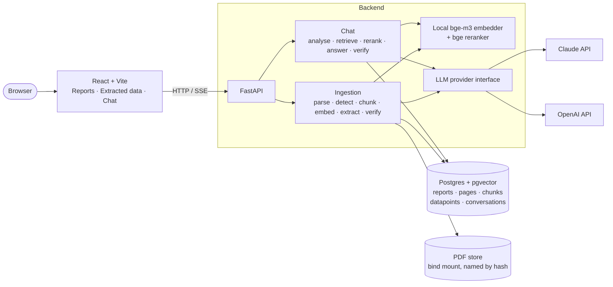

# Annual Report RAG Analyzer: Design

## Context

A local full-stack Retrieval-Augmented Generation (RAG) application for analysing company
annual reports (PDF): upload reports, ask questions in a chat, and browse datapoints that were
pre-extracted at ingestion. Every answer and every datapoint carries a verbatim quote that the
backend checks against the PDF text. This document records what was built and why; the README
covers how to run it and [PLAN.md](PLAN.md) what is done and what comes next.

## Architecture

One `docker compose up` starts `db`, `backend` and `frontend`. The frontend container is nginx
serving the built app and proxying `/api` to the backend, so the browser talks to one origin
and no CORS configuration is needed; the Vite dev server proxies the same way.

## Stack

| Layer | Choice | Why |
|---|---|---|
| Backend | FastAPI, Pydantic v2, SQLAlchemy 2 + Alembic, `sse-starlette`, `uv` | Typed, one process, server-sent events for the chat pipeline |
| Database | Postgres 16 + pgvector | One store for relational data, vectors and full-text search. Persists on a named volume |
| PDF parsing | PyMuPDF | Text blocks in reading order plus table boundaries; fast on CPU, no extra service. Scores 1.00 on the labelled page set (see Testing) |
| Embeddings | `BAAI/bge-m3`, local, via sentence-transformers | No API key. The index stays valid when the LLM provider changes |
| Reranker | `BAAI/bge-reranker-v2-m3`, local cross-encoder | Biggest precision gain for number questions; its score also drives abstention |
| LLM | Claude or OpenAI | See below |
| Frontend | React 19 + Vite + TypeScript, Tailwind v4, react-router | Three pages, typed API client, hand-written SSE parser |
| PDF viewing | Backend renders a cited page to PNG | One request per citation instead of loading a 400-page PDF in the browser; the full PDF is one click away |

## Model providers

Selected with `LLM_PROVIDER` in `.env`. Model names are settings too.

| Provider | Main model (answers, extraction) | Small model (metadata, query analysis) | Needs |
|---|---|---|---|
| Anthropic | `claude-sonnet-5-5` | `claude-haiku-4-5-20251001` | `ANTHROPIC_API_KEY`, plus `ANTHROPIC_WORKSPACE_ID` for user-scoped keys |
| OpenAI | `gpt-5` | `gpt-5-mini` | `OPENAI_API_KEY` |

- **One adapter per provider** behind a shared interface (`app/llm/base.py`): a system prompt,
  optional earlier conversation turns and the current user message, returning JSON for a
  Pydantic schema.
- **Structured output** uses each provider's JSON-schema mode (every property required, no
  additional properties). The reply is validated with Pydantic; on failure the validation error
  is sent back once as a repair retry.
- **Prompt caching.** The system prompt and the earlier turns are byte-identical across the
  requests of a conversation. Anthropic gets explicit cache breakpoints on the system prompt and
  the last earlier turn; OpenAI caches shared prefixes automatically.
- **Verbatim quotes are provider-agnostic.** The model returns a quote with a chunk id; the
  backend checks the quote against the stored page text (see Verification).

## Data model

- `reports`: company, fiscal_year, title, filename, file_hash (SHA-256, unique), page_count,
  status, progress, error. Company and year are detected during ingestion, so they are empty
  until the first stage has run.
- `pages`: report_id, page_no, text. The source of truth for verbatim checks and page citations.
- `chunks`: id (readable, `shell-2025-a1b2c3-p87-c412`), report_id, page, kind (`text` or
  `table`), content, embedding (pgvector), word_count, and a generated `tsvector` column with a
  GIN index for full-text search. A chunk never spans pages.
- `datapoints`: report_id, key (`fte`, `sustainability_goal`), label, value, numeric_value,
  unit, period, qualifiers (JSON), quote, chunk_id, page, verification (`verified`, `fuzzy`,
  `failed`), model.
- `conversations`, `messages`: chat history. An assistant message stores its status, its
  citations with their verification result, and metadata such as the standalone question and
  the retrieved chunk ids, so a reloaded conversation shows exactly what was shown live.

## Ingestion pipeline

A FastAPI background task with its own database session; status and progress are written to
the report row after every stage and the Reports page polls them. Uploads are deduplicated by
file hash; the PDF is stored as `<sha256>.pdf` and the original name kept in the database.

1. **Parse** (`ingestion/parser.py`). PyMuPDF text blocks sorted top to bottom, left to right;
   sorting whole blocks keeps paragraphs intact and two-column pages in order. Table
   boundaries come from `find_tables`, kept only when the table has at least 2 rows and 3
   numeric cells, which drops layout grids and navigation bars. For each table the raw text
   inside the boundary is stored, because cell extraction merges columns of borderless tables.
   Each page yields its full text and a body text with table regions removed.
2. **Detect metadata**. The small model reads the first three pages (2,500 characters each)
   and returns company, fiscal year and title. If the call fails the report keeps the file
   name as its company so it stays visible.
3. **Store pages** and **chunk** (`ingestion/chunker.py`). Each page body is cut into windows
   of 400 words with 60 words of overlap; each table is one chunk of its own. Chunks under 5
   words are dropped. No section structure is inferred.
4. **Embed**. The text embedded is the chunk behind a contextual header
   `[Company | Annual Report 2025 | p. 87]`, so the vector carries its context. Batches of 32;
   progress is updated per batch.
5. **Extract datapoints** (`extraction/extractor.py`, `extraction/registry.yaml`). Each
   registry entry has retrieval queries, a `top_k` and extraction instructions. Candidate
   chunks are the union of the best hits of every query, cut to `top_k` and passed to the main
   model in page order. Items are deduplicated on label, value and period. Adding a field is a
   config change; the Data page builds its sections from the registry endpoint.
6. **Verify** every quote (see Verification). The verification status is stored on the
   datapoint and shown as a badge.

Ingestion is in-process, so a report left mid-way by a restart can never finish; at startup
such reports are marked failed with a message asking to delete and re-upload. On a Mac the
embedder and reranker run on Metal, which is several times faster than CPU in Docker. Loading
a second model while the first is encoding crashes Metal, so model loading and inference share
one lock.

## Chat pipeline

`POST /api/chat` streams server-sent events: `conversation` (id and title), `stage` events
(`analyzing`, `retrieving`, `generating`), then one `answer` or `error`. The pipeline is
blocking (database, local models, LLM calls), so it runs in a worker thread and hands events
to the event loop through a queue.

1. **Query analysis**. The small model rewrites the latest question so it stands alone
   (pronouns and "that year" resolved from the conversation) and splits it into sub-queries.
   It sees every earlier question (the last 30) but answers only from the last six messages:
   questions are short and carry the company and year a follow-up refers to, often many
   turns back, while answers are long and only matter for what was just said. The raw
   questions are used rather than their earlier rewrites, so a wrong rewrite never feeds
   later ones. The split is
   one per company, fiscal year and topic it asks about: one for a simple question, two for
   "ASML vs ABN AMRO headcount", "ASML net sales 2024 vs 2025" or "ASML's net sales and
   headcount in 2025". A sub-query is a company, a fiscal year (of the annual report to
   search, never a target year such as "by 2030") and a standalone English question about one
   topic. The model picks company and year before it writes the question, and retrieval
   searches the question with a missing company or year appended, so every search names the
   report it is about without relying on the model's phrasing. At most 10 sub-queries are
   searched, each keeping its own top chunks, so no topic is crowded out by another's
   scores; the merged context is bounded by that cap. If the call fails the raw question is
   searched as one query.
2. **Scope**. Every sub-query searches every indexed report (`ready` or still `extracting`;
   the searches themselves skip chunks of other reports) and relies on the chunk headers,
   which name company and year, to find the right one. An explicit report filter from the
   sidebar narrows this and is never widened: if it matches no indexed report, the searches
   find nothing and the answer is "not stated". Filtering by the sub-query's
   company and year was measured as better (gold page in the context 0.98 vs 0.90, chunks from
   the right report 100% vs 83%) but fails silently on an unknown company or a wrong year; it
   is left out for now (see [PLAN.md](PLAN.md)).
3. **Hybrid retrieval** (`retrieval/search.py`), per sub-query. pgvector cosine search and
   Postgres full-text search on the sub-query's search text (its question, with the company
   or year appended if the question lacks them) each return 60 candidates, merged with
   Reciprocal Rank Fusion (k = 60). Full-text search matches any word of the question
   (`plainto_tsquery` with its ANDs turned into ORs, so text is never parsed as search
   syntax). An all-words query, as in the MVP, matched nothing for about half of real
   questions ([MVP_EVAL.md](MVP_EVAL.md)).
4. **Rerank** each sub-query's candidates with the cross-encoder, drop chunks scoring below
   0.2 and keep the top 8 of the rest; the sub-queries' chunks are merged, a chunk found
   twice kept once. The floor removes what a sub-query about a company outside the corpus
   would otherwise contribute: in the eval such questions scored 0.10 to 0.18 while every
   answerable question's best chunk scored 0.95 or more. If nothing is left, or nothing
   could be searched (no report ready, or none of the selected ones), the pipeline answers
   "not stated in the report" without calling the main model, saying which of the two it
   was. Plausible questions the reports do not answer score high anyway, so the model
   decides those: in the eval it said so for every one.
5. **Generate**. The main model gets the whole conversation as real turns, with this
   question's chunks in the final user message only. Earlier turns carry question and answer
   text, never their chunks, so each answer is grounded in and verified against this turn's
   evidence; sending them all keeps the prefix append-only, so the provider's prompt cache
   serves it. The reply is structured:
   status (`answered`, `partial`, `not_found`), answer text, citations with chunk id and quote.
6. **Verify** every citation. A citation of a chunk the model was never given fails. If an
   `answered` reply has no citation left that is verified or fuzzy, it is downgraded to
   `not_found`. Failed citations stay visible, struck through, with a count in the message.

## Verification

Every figure shown to the user comes with a quote, and the quote is checked in code, not by
the model. The model returns each claim as a `chunk_id` and a `quote` copied from that chunk;
`app/verify.py` decides whether the quote is really there.

1. **Was the chunk given to the model?** A citation of a chunk id that was not in the prompt
   is `failed` straight away.
2. **Sources.** The stored text of the chunk's page (`pages.text`, the source of truth) and
   the chunk's own text: a table chunk is text clipped to the table region, which can read
   differently from the page's block text. A match in either counts.
3. **Normalise** quote and sources: NFKC, typographic quotes and dashes unified, ligatures
   expanded, whitespace collapsed, lower-cased. Models do not reproduce PDF typography.
4. **Match.** An exact substring match is `verified`. Otherwise a RapidFuzz `partial_ratio`
   (best alignment of the quote against any window of the source) is computed; at or above
   0.92 the quote is `fuzzy`, below it `failed`. A quote longer than the source is compared
   whole, so a short table chunk inside a long invented quote does not score 1.

What the status does:

| Where | `verified` | `fuzzy` | `failed` |
|---|---|---|---|
| Chat citation | Green badge | Amber badge, counts as support | Struck through, counted in `dropped_citations` |
| Chat answer | | | An `answered` reply with no verified or fuzzy citation becomes `not_found`, and its text is replaced by "not stated in the report" (the original is kept in `meta.unverified_answer`) |
| Datapoint | Stored and shown with a badge | Same, with a warning badge | Still stored and shown, with a red badge |

What it guarantees and what it does not:

- A verified quote is on the cited page of the cited report, character for character after
  normalisation. The page link in the UI lets the user check it.
- The answer text itself is not checked: the model can still misread a correct quote.
- Fuzzy matching tolerates small edits, and a changed digit or an inserted "not" is a small
  edit (see below). Fuzzy is shown as a warning for this reason.
- The downgrade only applies to `answered` replies with at least one citation: an
  `answered` reply without citations, or a `partial` reply whose quotes all failed, keeps its
  status.

**RapidFuzz over `difflib`.** `difflib.SequenceMatcher` needs no dependency but is pure
Python and has no substring search, so it has to scan windows anchored on the quote's first
word: about 13 ms per quote, and a typo in that word fails the quote. RapidFuzz is a
compiled dependency whose `partial_ratio` checks every offset (about 0.3 ms per quote), but it
scores near-misses a few points higher. On a small generated set (60 sentences from the six
fixture reports, 570 variants) real quotes passed 96% of the time instead of 83%, and invented
text was rejected 100% by both. Neither catches a changed digit or an inserted "not" (both
accept over 90%); that needs a separate check, not a stricter threshold.

## Frontend

- **Reports**: drop PDFs or a folder (folders are walked recursively), upload them in one
  request, per-file rejections (not a PDF, already ingested), status badge and progress bar,
  polling only while something is ingesting, delete.
- **Extracted data**: one section per registry entry, cross-company. Single-value entries
  (FTE) show the value with qualifiers; multi-value entries (goals) list items. Each row has
  the verification badge, the quote and a page link that opens the page image in a side panel.
- **Chat**: saved conversations in a sidebar, a report filter, stage indicator while the
  pipeline runs, answer status badge, citation chips that open the cited page, the standalone
  question the search used.
- The header shows the configured provider, models and reranker so a demo always states what
  produced the answers.

## Testing

- **Unit** (offline): chunker windows and tables, quote verification, RRF merge, number
  parsing, provider repair retry and cache breakpoints, history budgeting, scope rules.
- **Parser quality**: 26 pages cut from the five real reports (financial tables, five-year
  tables, infographics, two-column text, pages with navigation bars) labelled in
  `backend/tests/fixtures/parsing.yaml` with text that must be recovered, cells that must land
  in a table, pages without tables and reading-order pairs. The test holds each category at a
  floor; `python -m tests.parsing_quality` prints the scorecard. All categories are at 1.00.
- **Integration/API**: FastAPI `TestClient` against a real Postgres and the configured
  provider: upload a generated PDF, wait for ingestion, check datapoints, chat, conversation
  ordering, page images, delete. Skipped when no API key is configured.
- **Frontend**: `tsc`, ESLint (type-checked rules) and Prettier; no browser tests.
- **CI**: GitHub Actions runs lint, unit tests, migrations and the integration test against a
  pgvector service container with a small embedding model.

## Alternatives considered

| Chosen | Alternative | Why not |
|---|---|---|
| Plain SDKs | LangChain, LlamaIndex | Heavy abstraction for a small pipeline, harder to debug and explain |
| Own provider interface | LiteLLM | Large dependency that hides structured-output differences |
| Quote and verify | Claude Citations API | Guaranteed verbatim, but Claude only |
| Postgres + pgvector | Chroma, Qdrant, SQLite | A second store to sync, or weaker full-text search |
| PyMuPDF | Docling, `pymupdf4llm`, LlamaParse, vision LLM | Slow on CPU, third-party upload, or high cost on 400 pages; PyMuPDF reached 1.00 on the labelled pages |
| Fixed word windows per page | Heading-based sections, semantic chunking | Headings in these reports are unreliable; windows with overlap are predictable and the page is the citation unit anyway |
| RapidFuzz `partial_ratio` | `difflib.SequenceMatcher` | No dependency, but 40x slower and misses quotes with a typo in the first word |
| Local `bge-m3` | OpenAI or Voyage embeddings | Ties the index to one vendor |
| Server-rendered page images | `react-pdf` / pdf.js in the browser | A 400-page PDF per citation is slow; one PNG per cited page is not |
| Chunk RAG | Whole report in context, GraphRAG, agents | Slow and costly on 400 pages, or out of scope |
| React | Streamlit | Faster to write, but weak citation and PDF control |
| Background task | Celery + Redis | Extra service for a single-user demo |

## Drawbacks and risks

| Drawback | Mitigation |
|---|---|
| Two providers double the test surface | Shared prompts, Pydantic validation, one integration test per configured provider |
| Strict quote check can flag correct answers | Text normalisation, labelled fuzzy fallback with a threshold constant |
| A verified quote can still be misread | Stated limitation; a golden question set is the next step |
| Embedding 400 pages on CPU takes 10 to 15 minutes | Background ingestion with progress; Metal on a Mac brings it to about 2 minutes |
| First run downloads about 4.5 GB of models | Cached in a named volume, stated in the README |
| A restart kills an in-process ingestion | Marked failed at startup with a clear message; re-upload |
| Charts and infographics are not read | Stated limitation; vision parsing is the next step |
| Cloud APIs see report content | The reports are public |

## Status

What is done and what comes next, by area (evaluation, retrieval, extraction, verification,
UI), is tracked in [PLAN.md](PLAN.md).
